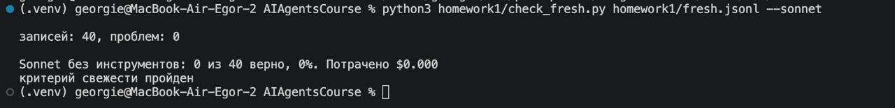
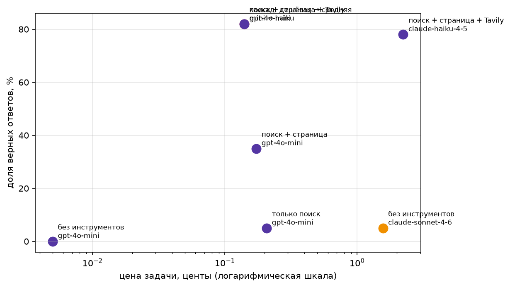

# ДЗ 1. Свежие вопросы и агент, который на них отвечает

Весь код агента и тесты инструментов — в ноутбуке [homework1.ipynb](homework1.ipynb), отдельных модулей нет. Ноутбук идёт по шагам семинара, затем тестируется на собственном датасете

Модели как на семинаре: дешёвая openai/gpt-4o-mini, средняя anthropic/claude-haiku-4.5,
сильная anthropic/claude-sonnet-4.6

Добавоен поиск с Tavily, без него всё остальное работает, а конфигурация
с Tavily пропускается.

## Датасет
Тема: сезон формулы 1 2026. Вариант 2 задания: свой набор из 40 вопросов на одну тему, все на русском. 

Факты собраны из русской википедии, статьи о 17 этапах с марта по октябрь и статья «Формула-1 в сезоне 2026». Это штрафы на решётке, позиции после штрафов, пустые места на старте, замены гонщиков, даты отмены и переноса Гран-при Бахрейна и решения апелляционного суда ФИА. Датасет собирался вручную в экселевском файле - f1_2026.xlsx. Названия столбцов как в .jsonl файле примера. Ответы-имена записаны фамилией («Гасли», «Хиракава»): так засчитывается ответ при любом написании имени. 

## Проверка свежести
Проверка свежести пройдена!

## Результаты агентов с различными конфигурациями

### Сравнительная таблица
|   | config                     | model            |  n | accuracy | cost_per_task | cost_per_correct | avg_steps | avg_seconds |
|--:|:---------------------------|:-----------------|---:|---------:|--------------:|-----------------:|----------:|------------:|
| 0 | без инструментов           | gpt-4o-mini      | 40 |     0.00 |       0.00005 |              inf |      1.00 |         1.2 |
| 1 | каскад: дешёвая → средняя  | mini → haiku     | 40 |     0.82 |       0.00140 |          0.00170 |      5.18 |        13.0 |
| 2 | поиск + страница + Tavily  | gpt-4o-mini      | 40 |     0.82 |       0.00140 |          0.00170 |      5.18 |        13.0 |
| 3 | поиск + страница           | gpt-4o-mini      | 40 |     0.35 |       0.00173 |          0.00493 |      7.02 |        18.3 |
| 4 | только поиск               | gpt-4o-mini      | 40 |     0.05 |       0.00207 |          0.04135 |      8.38 |        22.4 |
| 5 | без инструментов           | claude-sonnet-4-6| 40 |     0.05 |       0.01568 |          0.31362 |      1.00 |        15.9 |
| 6 | поиск + страница + Tavily  | claude-haiku-4-5 | 40 |     0.78 |       0.02230 |          0.02877 |      3.40 |        11.2 |

### График сравнения стоимости

## Провалы
Провал 1 (Лоусон, Италия): нашёл не то. Агент сразу открыл правильную статью «Гран-при Италии 2026 года», но page_find вернул вступление вместо строки «Лиам Лоусон оштрафован на 35 позиций». Модель положила в ключевые слова название статьи («Гран-при Италии 2026»), а эти слова есть во вступлении. Нужная строка совпала только по двум словам из шести и не прошла порог «половина слов». Дальше агент искал не там, кончились шаги, и после мягкого завершения он выдумал «10».

Провал 2 (Берман, Венгрия): нашёл не то, по той же причине. Правильная статья найдена, ключевые слова «Оливер Берман Гран-при Венгрии 2026», и page_find снова вернул вступление вместо строки с «классифицирован 19-м». Здесь агент честно ответил unknown.

##  Вывод
Тезис подтвердился: дешёвый агент (gpt-4o-mini с поиском, чтением страницы и Tavily) ответил верно на 82% вопросов, Sonnet без инструментов — на 5%. При этом агент в 11 раз дешевле за задачу и примерно в 185 раз дешевле за верный ответ. Одного поиска мало (5%), чтение страницы даёт 35%, Tavily — 82%. Haiku с тем же набором инструментов ответил на 78%, то есть не лучше дешёвой модели, а стоит в 16 раз дороже. Каскад ничего не дал, потому что дешёвый агент ни разу не ответил unknown, поэтому ни один вопрос не ушёл к средней модели. 